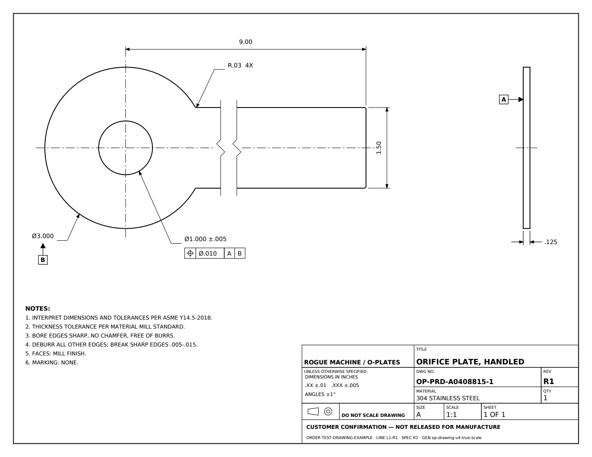
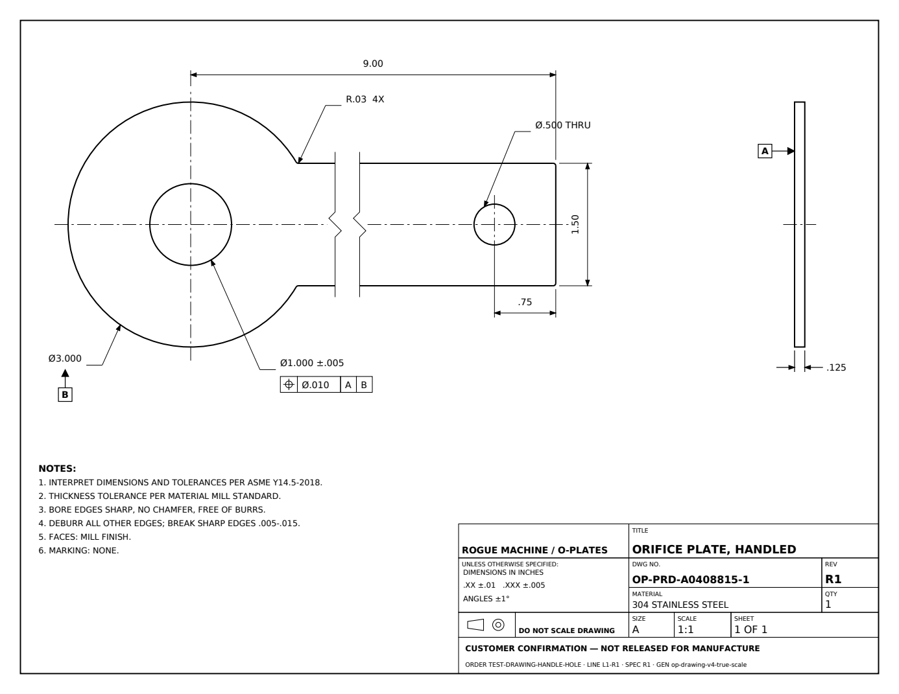
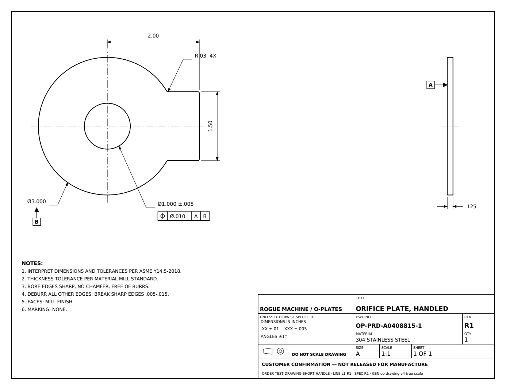

# O-Plates true-scale drawing — review report

2026-10-20. Branch: `work/drawing-true-scale-broken-view`.
Base: `34707eb`, `work/final-integration-production-cutover` (not main).

**Status: ready for owner visual review. PR #31 is open and unmerged; isolated staging is live and verified. Full local suite and deployed-commit CI are green. No production change.**

- [Open staging review](https://oplates-drawing-review.onrender.com)
- [Open PR #31](https://github.com/roguemach-design/orifice-pricing-engine/pull/31)
- [CI for deployed commit](https://github.com/roguemach-design/orifice-pricing-engine/actions/runs/39400952801)

## What changed

- `drawing_presentation.py` chooses a single scale and maps canonical geometry into ANSI A landscape paper coordinates for both outputs. No feature-specific radius, bore, handle, or thickness clamps remain.
- Candidate scales are 1:1, 1:2, 1:4, plus the owner-approved 1:8 and 1:16 fallbacks. The drawing zone is 560 × 288 points with separate annotation, edge-view, notes, and title-block space. Ø6 selects 1:2; the existing Ø48 configuration selects 1:16. A short handle remains unbroken whenever it fits.
- Long handles have two thin long-break lines with one zigzag each and a .30-inch paper gap. The first break is .45 true inch beyond the canonical straight-handle neck tangent (`PlateGeometry.join_x`), clearing its exact fillet. This uses the canonical tangent rather than the reference script's unfilleted circle intersection.
- Kept tip is `max(2.4, hole distance from end + hole radius + .9)` true inches. Hole geometry and its end-location dimension stay in the retained tip. The handle length dimension spans the break continuously and displays the true length.
- The PDF uses a right-facing plan and aligned, uniformly scaled right-side edge view. Existing Detail B geometry, angle/face interpretation, hatching, supplied dimensions, and explicit flow indication are preserved and relocated. The cropped detail states its actual enlargement.
- PDF content now uses the requested datum A/B symbols, bore position frame, numbered notes, compact title block, inch decimal conventions and confirmation status. Supplied finish/inspection/marking requirements are retained; missing fields no longer create visible HOLD placeholders. Incomplete chamfer inputs remain explicitly incomplete, without inventing a bevel or changing internal HOLD rules.
- Full IDs and geometry provenance remain in PDF metadata; visible IDs are shortened. No existing stored Frozen Plate artifacts were read, regenerated, or replaced.
- The responsive SVG uses the identical presentation model and keeps its configuration-preview disclaimer.
- `drawing_review_app.py` is a read-only synthetic review harness with six samples. It requires `DRAWING_REVIEW_ONLY=true`, rejects `APP_ENV=production`, has no checkout/email/database bindings, and serves the same renderer outputs. It is deployed only to the isolated review service described below.

## Owner decisions and named constants

The following are all in `drawing_standards.py`, marked `PROPOSED_PENDING_OWNER = True` as directed. They are presentation proposals, not manufacturing capability claims or changes to canonical specs.

| Item | Proposed setting |
| --- | --- |
| UOS | .XX ±.01; .XXX ±.005; angles ±1° |
| Bore position | Ø.010 RFS to A, B |
| Display precision | OD/bore/hole diameter: 3 places; handle width/length/hole location/radius: 2 |
| Handle hole tolerance | Block tolerance; no FCF |
| Edge break | .005-.015 |
| Face finish | Mill finish |

**Approved separately by owner in chat:** add 1:8 and 1:16 scale fallbacks, retaining ANSI A landscape.

## Verification

| Check | Result |
| --- | --- |
| Unchanged base suite | 916 passed, 5 skipped |
| Serialized SVG/PDF parity, break, dimensions, scale, identity and isolation tests | 25 passed |
| Renderer, manufacturing, section, configurator convergence and application regression group | 164 passed |
| Isolated review service checks | 2 passed |
| Intake-focused regression | 215 passed, 5 skipped, 19 presentation tests deselected |
| Full suite before verifier authorization | 891 passed, 52 failed, 5 skipped |
| Full suite after approved verifier adaptation | **973 passed, 5 skipped** |
| PDF verifier and Frozen Plate focused regression | **75 passed** |
| Exact artifact comparison | **51 SHA-256 values unchanged** |
| Source scope | Canonical geometry, section geometry, DXF/JSON exporters, Haas and packaging generators unchanged |
| Git diff whitespace / Python compilation | Passed |
| CI for deployed commit | **973 passed, 5 skipped; compile passed** |
| Staging artifacts | **6 PDF/SVG pairs byte-identical to local outputs** |
| Synthetic Frozen Plate verification | **2 TEST orders: exact frozen PDF, captured attachment and idempotent approval** |

The parity matrix measures serialized SVG radii/coordinates and actual PDF cubic-path extrema, circles, lines and edge rectangles, independently of the presentation mapper. It covers small/large OD, small/large bore ratios, short and long handles, near/far handle holes, wide handles, and chamfer on/off. Ratios and true kept lengths must agree within 0.5%.

`exact-output-baseline.json` was captured before modifying either renderer under the repository's pinned dependencies. It covers DXF, internal JSON and exact SVG for standard/long/hole/chamfer cases, all associated packaging outputs, and all sample Haas outputs. The current outputs match all 51 hashes. Pricing/payload/spec/DXF convergence checks retain the prior baseline, with separate fixtures only for changed PDF/configurator SVG bytes.

All existing tests are retained. See [changed-assertions.md](changed-assertions.md) for every changed assertion, expected-label loop, or fixture reference and its reason. The prior golden fixtures remain intact.

## Approved PDF verifier integration

The owner selected option 1 on 2026-10-20, explicitly authorizing the narrow PDF-format verifier update, the named GitHub branch/PR, and isolated free Render staging in `roguemachine`.

The previous verifier required four-place handle-hole strings and full visible prototype/production IDs. Its 52 downstream failures have been resolved by a versioned PDF presentation adapter. V4 requires exact full part/order/geometry/generator/state identity in PDF provenance plus the new visible finished dimensions, drawing number, revision and traceability line. V3e retains its legacy format checks and is exercised using actual PDF bytes from the unchanged base renderer.

Thirty new tests cover accepted v4 and v3e packages, altered visible dimensions and IDs, wrong/missing/malformed provenance, shortened-ID collisions, and legacy hole tampering. No existing assertions were changed in this integration follow-up. All existing DXF, JSON, hash, revision, approval, supersession, authorization and release checks remain in place. No pricing/input validation, order schema, auth, Stripe, storage, or Frozen Plate state semantics were changed.

An earlier automatic approval review rejected the GitHub push because repository authorization was only in the attachment. It was not bypassed. The owner's subsequent explicit chat approval now covers pushing `work/drawing-true-scale-broken-view` to `roguemach-design/orifice-pricing-engine`, opening an unmerged PR against `work/final-integration-production-cutover`, and isolated staging. Production and merging remain excluded.

## Staging evidence

- URL: https://oplates-drawing-review.onrender.com
- Service: `srv-dbbj8nbrjlhs73ef06og`; workspace `roguemachine`; Ohio; free plan; automatic deployment off.
- Deploy: `dep-dbbj8nrrjlhs73ef08o0`, confirmed live on 2026-10-20.
- Deployed runtime commit: `bc1c88ee0792a9321fe42ae81f17cfc40e1aa1f0`.
- `/health` reports that exact commit, `op-drawing-v4-true-scale`, and synthetic review mode.
- All six deployed PDF/SVG pairs match local outputs byte for byte. PNGs below were rendered from the **downloaded staging PDFs**.
- Sample selection returns 200, an unknown PDF returns 404, and POST to a sample returns 405. Responses have noindex/nofollow and nosniff headers.
- The exact example and handle-hole staging PDFs also match R1 artifacts generated through the real Frozen Plate code in a disposable **local** SQLite TEST repository. Captured MIME attachments contain those exact bytes; approvals bind their PDF/spec hashes and remain idempotent. No external email, customer database or real order was used.
- [Machine-readable verification](staging/verification.json); reproducible check: `scripts/verify_true_scale_staging.py`.
- Staging is pinned to the verified runtime commit. Later report/evidence commits do not change the deployed renderer.

## Visual comparisons

These are synthetic TEST drawings. The supplied production example was reconstructed from the assignment's dimensions; neither the real order nor its stored R1 was changed.

| Supplied target | PDF fetched from staging |
| --- | --- |
|  |  |
|  |  |

| Matching configurator SVG | Additional staging cases |
| --- | --- |
|  |  |
|  |  |
|  |  |

## Review boundary

The named manufacturing standards remain proposals marked `PROPOSED_PENDING_OWNER`; the approved fallback scales are recorded separately. The company title uses the repository's embedded standard font because no Spy Agency font asset is present. No pricing, input validation, checkout, auth, Stripe, Supabase or drawing-intake implementation was changed. The only validation change is the explicitly approved PDF-format adapter. Historical artifacts, shared staging services and production remain untouched. This PR is not merged.
