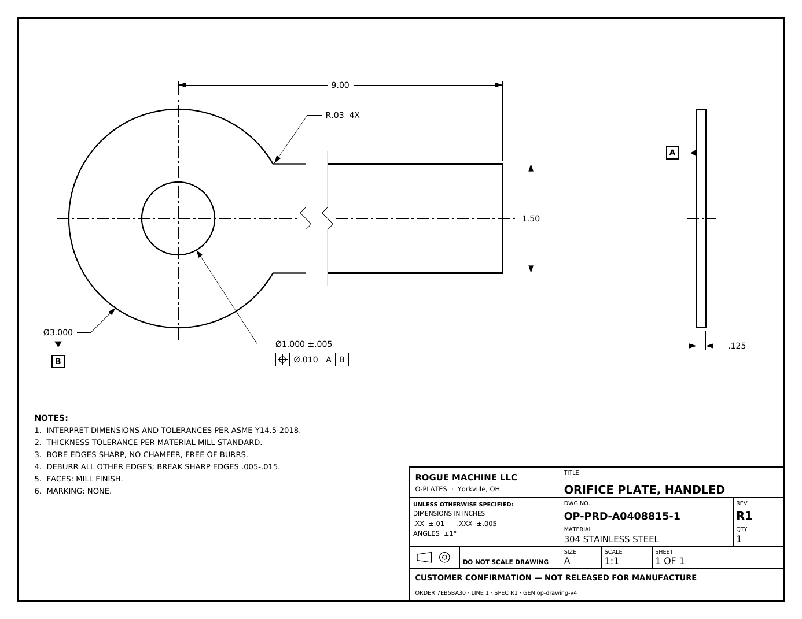
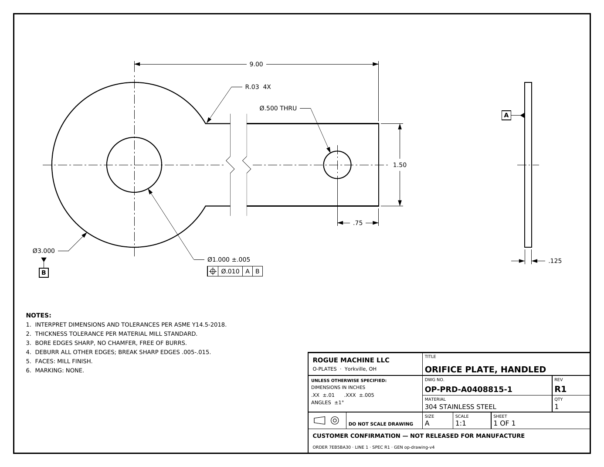
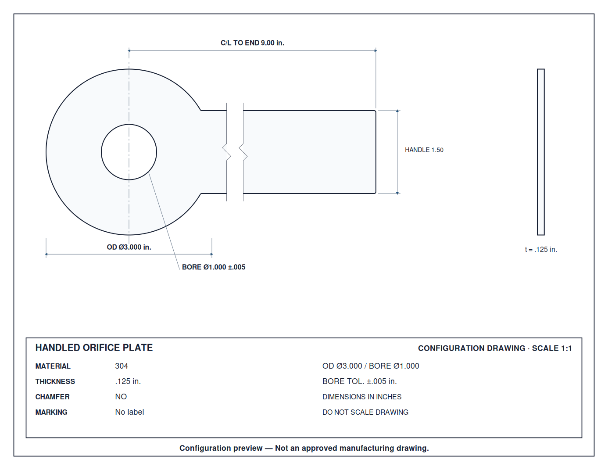
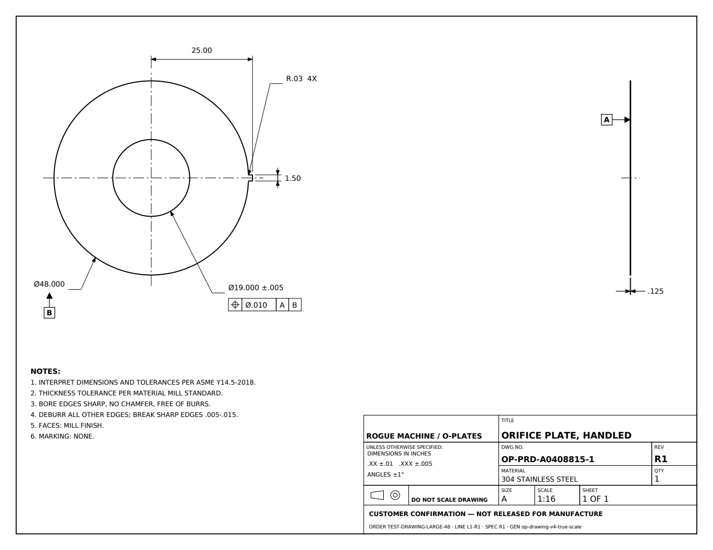
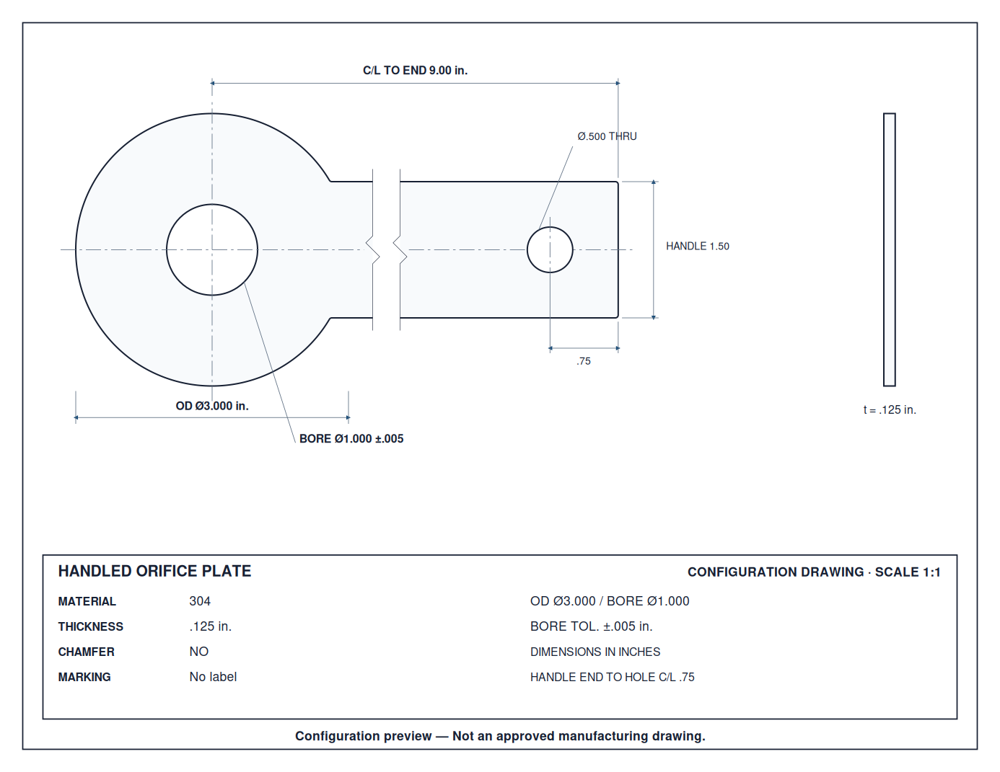
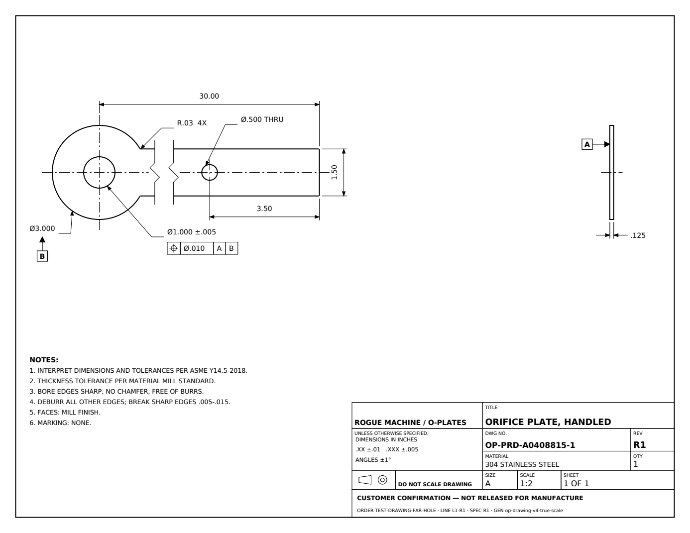
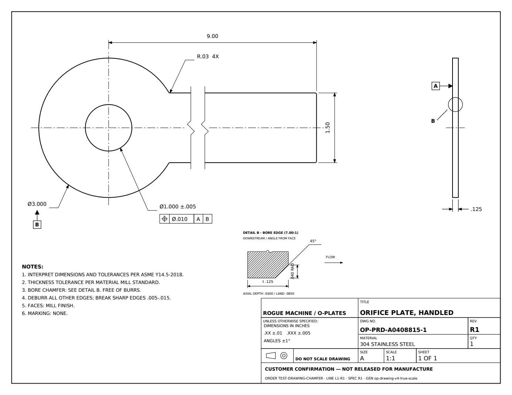

# O-Plates true-scale drawing — review checkpoint

2026-10-20. Local branch: `work/drawing-true-scale-broken-view`.
Base: `34707eb`, `work/final-integration-production-cutover` (not main).

**Status: renderer implemented and locally reviewed; integration blocked pending narrow owner authorization. No PR, CI run, staging deployment, merge, or production change has occurred.**

## What changed

- `drawing_presentation.py` chooses a single scale and maps canonical geometry into ANSI A landscape paper coordinates for both outputs. No feature-specific radius, bore, handle, or thickness clamps remain.
- Candidate scales are 1:1, 1:2, 1:4, plus the owner-approved 1:8 and 1:16 fallbacks. The drawing zone is 560 × 288 points with separate annotation, edge-view, notes, and title-block space. Ø6 selects 1:2; the existing Ø48 configuration selects 1:16. A short handle remains unbroken whenever it fits.
- Long handles have two thin long-break lines with one zigzag each and a .30-inch paper gap. The first break is .45 true inch beyond the canonical straight-handle neck tangent (`PlateGeometry.join_x`), clearing its exact fillet. This uses the canonical tangent rather than the reference script's unfilleted circle intersection.
- Kept tip is `max(2.4, hole distance from end + hole radius + .9)` true inches. Hole geometry and its end-location dimension stay in the retained tip. The handle length dimension spans the break continuously and displays the true length.
- The PDF uses a right-facing plan and aligned, uniformly scaled right-side edge view. Existing Detail B geometry, angle/face interpretation, hatching, supplied dimensions, and explicit flow indication are preserved and relocated. The cropped detail states its actual enlargement.
- PDF content now uses the requested datum A/B symbols, bore position frame, numbered notes, compact title block, inch decimal conventions and confirmation status. Supplied finish/inspection/marking requirements are retained; missing fields no longer create visible HOLD placeholders. Incomplete chamfer inputs remain explicitly incomplete, without inventing a bevel or changing internal HOLD rules.
- Full IDs and geometry provenance remain in PDF metadata; visible IDs are shortened. No existing stored Frozen Plate artifacts were read, regenerated, or replaced.
- The responsive SVG uses the identical presentation model and keeps its configuration-preview disclaimer.
- `drawing_review_app.py` is a read-only synthetic review harness with six samples. It requires `DRAWING_REVIEW_ONLY=true`, rejects `APP_ENV=production`, has no checkout/email/database bindings, and serves the same renderer outputs. It has not been deployed.

## Owner decisions and named constants

The following are all in `drawing_standards.py`, marked `PROPOSED_PENDING_OWNER = True` as directed. They are presentation proposals, not manufacturing capability claims or changes to canonical specs.

| Item | Proposed setting |
| --- | --- |
| UOS | .XX ±.01; .XXX ±.005; angles ±1° |
| Bore position | Ø.010 RFS to A, B |
| Display precision | OD/bore/hole diameter: 3 places; handle width/length/hole location/radius: 2 |
| Handle hole tolerance | Block tolerance; no FCF |
| Edge break | .005-.015 |
| Face finish | Mill finish |

**Approved separately by owner in chat:** add 1:8 and 1:16 scale fallbacks, retaining ANSI A landscape.

## Verification

| Check | Result |
| --- | --- |
| Unchanged base suite | 916 passed, 5 skipped |
| Serialized SVG/PDF parity, break, dimensions, scale, identity and isolation tests | 25 passed |
| Renderer, manufacturing, section, configurator convergence and application regression group | 164 passed |
| Isolated review service checks | 2 passed |
| Intake-focused regression | 215 passed, 5 skipped, 19 presentation tests deselected |
| Full final local suite | **891 passed, 52 failed, 5 skipped** |
| Exact artifact comparison | **51 SHA-256 values unchanged** |
| Source scope | Canonical geometry, section geometry, DXF/JSON exporters, Haas and packaging generators unchanged |
| Git diff whitespace / Python compilation | Passed |
| CI / deployment | Not run; push blocked by automatic approval review |

The parity matrix measures serialized SVG radii/coordinates and actual PDF cubic-path extrema, circles, lines and edge rectangles, independently of the presentation mapper. It covers small/large OD, small/large bore ratios, short and long handles, near/far handle holes, wide handles, and chamfer on/off. Ratios and true kept lengths must agree within 0.5%.

`exact-output-baseline.json` was captured before modifying either renderer under the repository's pinned dependencies. It covers DXF, internal JSON and exact SVG for standard/long/hole/chamfer cases, all associated packaging outputs, and all sample Haas outputs. The current outputs match all 51 hashes. Pricing/payload/spec/DXF convergence checks retain the prior baseline, with separate fixtures only for changed PDF/configurator SVG bytes.

All existing tests are retained. See [changed-assertions.md](changed-assertions.md) for every changed assertion, expected-label loop, or fixture reference and its reason. The prior golden fixtures remain intact.

## Integration blocker — proposed narrow extension

`frozen_plate/validation.py` is unchanged because validation is explicitly out of scope in the handoff. Its PDF checks require legacy strings:

- `HANDLE HOLE Ø0.3750` and `0.7500 HANDLE END TO HOLE C/L`;
- the full `OP-` + canonical part identifier, including `PROTOTYPE-001` or long production IDs.

Those requirements conflict with the requested three/two-place inch labels, THRU callout, shortened visible IDs, and removal of prototype wording. The verifier correctly refuses the new drawing under its old format contract; downstream freeze/checkout tests then remain on HOLD or have no revision to approve. No checks have been bypassed and no failed tests have been skipped.

**Proposed extension:** update only this verifier's PDF presentation adapter to recognize v4 labels and shortened visible drawing IDs while checking exact identity against PDF provenance and preserving visible dimension checks. Keep legacy-format support where needed and retain all existing DXF, JSON, hash, revision, approval, supersession, authorization and release checks. Add tampered-PDF regression cases. Do not change pricing/input validation, order schema, auth, Stripe, storage, or Frozen Plate state semantics.

## Publication blocker

Automatic approval review rejected the attempted push to `roguemach-design/orifice-pricing-engine`, stating that internal source would go to an unverified external destination and the trusted chat messages did not explicitly authorize that repository/disclosure. The repository and PR instructions are in the attached assignment. The push was not retried through another tool or route; read-only remote inspection found no new branch.

An explicit chat authorization is needed to push the named branch to that repository, open the PR targeting `work/final-integration-production-cutover`, and deploy the isolated free staging review service in the existing `roguemachine` Render workspace. No merge or production deployment is requested.

## Visual comparisons

These are **local synthetic renders**, not staging evidence. The supplied production example was reconstructed from the assignment's dimensions, with a TEST traceability line. It does not alter the real order or stored R1.

| Supplied target | New local PDF |
| --- | --- |
|  |  |
|  |  |

| Matching configurator SVG | Additional review cases |
| --- | --- |
|  |  |
|  |  |
|  |  |

## Next steps after owner authorization

1. Make the narrowly scoped verifier adaptation and prove tamper rejection and legacy compatibility.
2. Run the full suite to green, then push focused commits and create the unmerged PR against the cutover branch.
3. Deploy isolated staging, verify the exact deployed commit, fetch PDF/SVG bytes from staging and render comparison PNGs.
4. Complete a synthetic Frozen Plate TEST-order generation/approval-path check and record results. Production and historical artifacts remain untouched.
